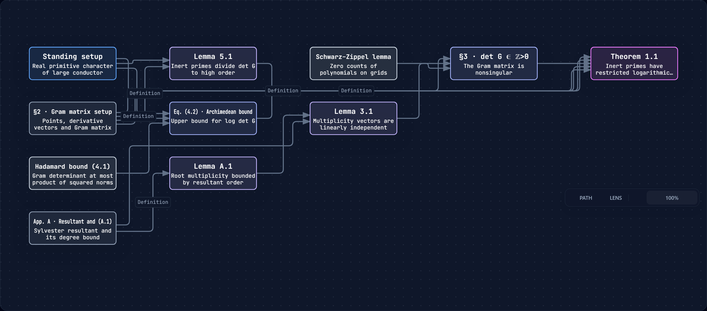

# Proof Graphify

Proof Graphify shows how a paper's main theorems depend on lemmas, assumptions, and key intermediate results. Proof Check extends this view with a language model's assessment of the written proof. Neither skill produces or verifies Lean proofs.

| Skill | Version | What it does |
|---|---|---|
| `proof-graphify` | v3.4.13 | Maps selected results in an interactive graph where you can follow each dependency back to its statement and source. |
| `stat-proof-check` | v3.4.13 | Examines individual proof steps and reports gaps or unresolved questions alongside the affected result. |

## Example: On Landau–Siegel zeros

In Ben Green’s [*On Landau–Siegel zeros*, v1](https://hexagonmath.org/2610.00311v1), three facts about the same Gram determinant lead to Theorem 1.1. The determinant is a positive integer, its size has an upper bound, and certain primes must divide it to high powers. The graph shows how these facts combine to bound a weighted sum over those primes.

The example was generated with Proof Graphify v3.4.16. Download the [interactive graph](examples/landau-siegel/overview.html) and open it in your browser. Select Theorem 1.1 to read the bound and follow its prerequisites.

## Workflow

Starting from a TeX manuscript or PDF, each skill uses Python to write statements, source passages, and dependencies to its own SQLite database. A shared renderer turns those records into a standalone HTML graph. Its visual design and graph controls draw on [Archify](https://github.com/tt-a1i/archify).

## Install

Copy the `proof-graphify/` or `stat-proof-check/` folder from this repository into `~/.agents/skills/` (Codex) or `~/.claude/skills/` (Claude Code). Keep the folder name and all its contents. To use the skill, ask `$proof-graphify` to map a paper or `$stat-proof-check` to audit it.

## License

The software is [MIT licensed](LICENSE). Green’s paper and the excerpts in the example are licensed under [CC BY 4.0](https://creativecommons.org/licenses/by/4.0/).
