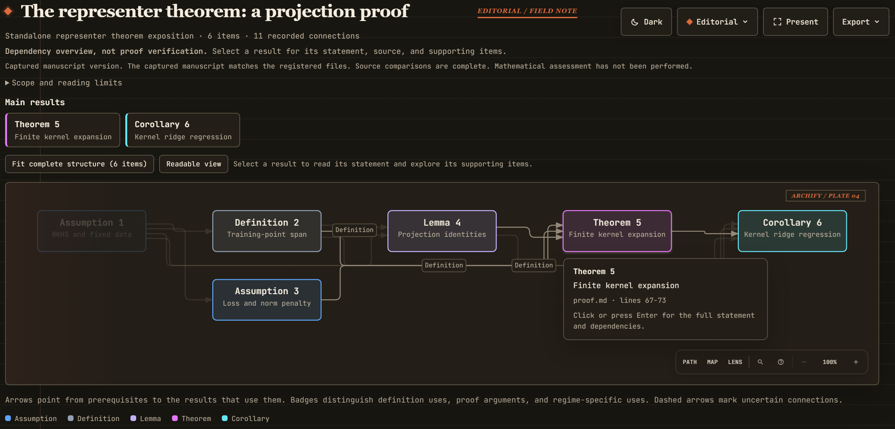

# Proof Graphify

[](proof-graphify/SKILL.md)

**Explore a paper's main results, important prerequisites, and connections in the style of [Archify](https://github.com/tt-a1i/archify).**

The skill selects the results that explain the paper's central contributions, records faithful summaries, proof ideas, and sourced connections in a local SQLite database, and generates an interactive HTML graph. Expanded cards distinguish statements from the reasoning that connects their prerequisites. Follow the argument and inspect source passages without reconstructing individual proof steps. The selected scope is visible; unselected declarations do not require exhaustive bookkeeping.

The records remain reusable: [revise the overview](proof-graphify/references/revisions.md) as the manuscript changes. A new proofcheck audit starts independently from the manuscript in its own folder and database. Source comparison checks the overview against the paper; it does not certify proof validity. Existing detailed databases retain their content and history through the [compatibility and maintenance guidance](proof-graphify/references/audit-database.md).

[](proof-graphify/examples/overview-browser.png)

Open the [example HTML](proof-graphify/examples/representer-theorem/overview.html) locally to explore statements and trace dependencies. Read its [source proof](proof-graphify/examples/representer-theorem/proof.md).

[`stat-proof-check`](stat-proof-check/README.md) is an extended version of Proof Graphify that builds more detailed items within a proof and uses LLMs to check their reasoning and dependencies. The two skills share a common core and presentation interface. Its checks are non-formal: it does not produce a Lean proof or provide formal verification.

## Skills in this repository

This repository maintains two independently installable skills for understanding mathematical papers. They share a maintained backend and reader, while keeping separate scientific workflows.

| Skill | Version | Main use |
|---|---|---|
| `proof-graphify` | v3.2.9 | Build a selective, source-backed map of main results and important prerequisites |
| `stat-proof-check` | v3.2.8 | Audit written mathematical arguments with independent review and explicit findings |

The shared `paper_core` version is `3.2.8`. Skill and core versions are independent: bump the affected skill for workflow changes, and bump the core when its implementation changes. Source comparisons in Graphify do not establish proof validity. A new Proof Check audit starts independently from the manuscript in its own folder and database. Proof Check runs only when explicitly invoked as `$stat-proof-check`.

## Repository layout

```text
proof-graphify/                     Git repository
  proof-graphify/                   installable overview skill
    SKILL.md
    scripts/paper_core/             generated self-contained backend
  stat-proof-check/                 installable audit skill
    SKILL.md
    scripts/paper_core/             identical generated backend
  shared/paper_core/                maintained common source
  tools/                           bundle builder and Proof Check installer
  tests/                           repository compatibility tests and fixtures
  architecture/                    shared and audit architecture records
    proof-graphify/                 overview architecture
```

The repository root is a development checkout. Install the selected skill subdirectory. Neither skill requires the other skill, the repository's `shared/` directory, or a sibling checkout at runtime. The [stat-paper-skills repository](https://github.com/rqzhu-aide/stat-paper-skills) now maintains manuscript writing, paper review, and proof writing.

## Use and installation

Install `proof-graphify/` as `~/.agents/skills/proof-graphify/` or `~/.claude/skills/proof-graphify/`, then ask:

```text
Use proof-graphify to map this paper's main results and the important prerequisites that explain them, including relevant appendix results.
```

Install `stat-proof-check/` as `~/.agents/skills/stat-proof-check/` or `~/.claude/skills/stat-proof-check/`. From this repository root, the validated installer can install the audit package:

```powershell
python -B tools/install_proofcheck.py --source stat-proof-check --target agents --target claude
```

It validates the bundle, stages the package, and verifies each installed copy. Existing installations require the installer's `--upgrade` option; old skill names must leave skill discovery first. For Claude, retain `"stat-proof-check": "user-invocable-only"` under `skillOverrides`. Then ask:

```text
Use $stat-proof-check to audit this theorem and its prerequisite arguments.
```

Use shared Python 3.12+ for repository development and Graphify, with shared Node.js and `latex2mathml`; Graphify's PDF extraction uses `pypdf`. The installed Proof Check Python helpers support Python 3.10+, and its HTML delivery uses Node.js. Optional offline LaTeX conversion uses shared `latex2mathml`. Refresh skill discovery or restart the host if a newly installed skill is not visible. The individual [overview guide](proof-graphify/README.md) and [audit guide](stat-proof-check/README.md) describe their outputs and workflows.

## Shared backend and validation

Edit [`shared/paper_core`](shared/paper_core), then run `python -B tools/build_paper_core_bundles.py` to generate both packages' byte-identical cores and manifests. Product entrypoints and scientific scopes remain separate. The builder's `--check` verifies both bundles without rewriting them; Proof Check also provides `scripts/build_manifest.py --check` for its installed package.

Run the relevant checks with a shared Python installation:

```text
python -B tools/build_paper_core_bundles.py --check
python -B stat-proof-check/scripts/build_manifest.py --check
python -B -m unittest discover -s proof-graphify/tests
python -B -m unittest discover -s stat-proof-check/tests -p "test_v3*.py"
python -B -m unittest discover -s stat-proof-check/tests -p test_skill_structure.py
python -B -m unittest discover -s tools -p test_install_proofcheck.py
python -B -m unittest discover -s tools -p test_bundle_targets.py
```

The [architecture index](architecture/README.md) explains ownership and separates current implementation from historical records. `tests/new_format` retains compatibility and migration cases alongside historical audit expectations; it does not define the current audit workflow. Software checks do not establish mathematical correctness or whole-paper audit performance. Dated handoffs and validation reports retain their original versions and paths as historical evidence.

[MIT license](LICENSE)
